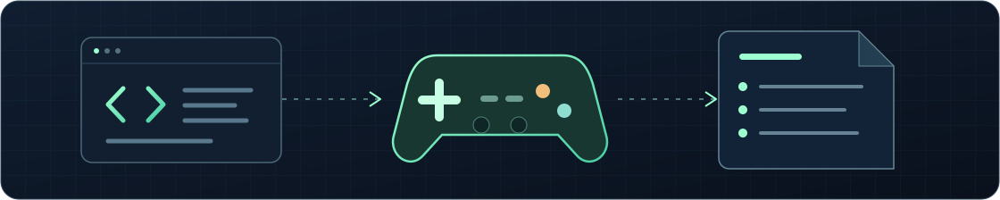
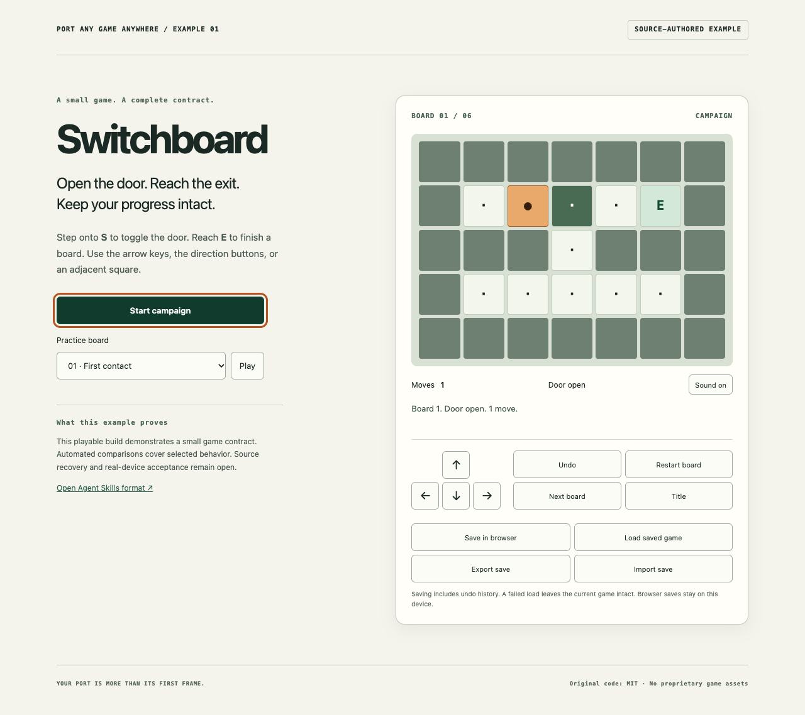
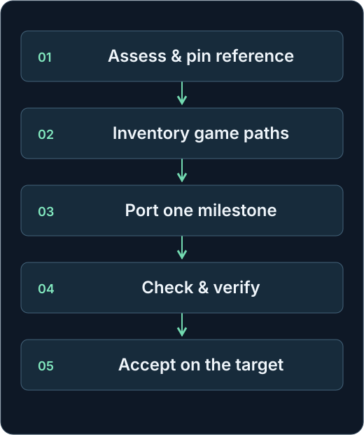

<div align="center">



<h1>Port Any Game Anywhere</h1>

<p>a skill for efficient &amp; faithful agentic retro game development.</p>

<p>
<a href="https://github.com/t3chnaztea/port-any-game-anywhere/actions/workflows/checks.yml"></a>
<a href="LICENSE"></a>
<a href="https://agentskills.io/specification"></a>
<a href="STATUS.md"></a>
</p>

<p><a href="#start-here"><strong>Start here</strong></a> &nbsp;·&nbsp; <a href="#see-the-example">Example</a> &nbsp;·&nbsp; <a href="#the-workflow">Workflow</a> &nbsp;·&nbsp; <a href="STATUS.md">Status</a> &nbsp;·&nbsp; <a href="CONTRIBUTING.md">Contribute</a></p>

</div>

We're living in a golden age of retro gaming. New tools and AI coding agents make projects that once felt out of reach possible. For me, that project was a childhood wish: **Sonic CD on Sega Saturn.**

I started building the port. Getting it to run was exciting. Making it behave like the game I remembered meant checking the physics, saves, sound, controls, and paths through the game. Those details became a process I could repeat.

**Port Any Game Anywhere** grew out of that work. It's a skill, a set of instructions your coding agent follows, for people who love retro games and want to build ports, even if software engineering isn't their day job. It helps you plan the work, guide the agent, and check what it builds, with the goal of a port that plays and feels faithful to the original.

**Development preview.** Codex has been checked with a small planning task. Other clients, blind recovery, paired agent comparisons, and physical-device acceptance remain unverified. [Status and known issues →](STATUS.md)

## Start here

From a checkout, install the whole folder for Codex. Move an existing installation aside first.

```sh
git clone https://github.com/t3chnaztea/port-any-game-anywhere.git
cd port-any-game-anywhere
mkdir -p ~/.agents/skills
cp -R skills/port-any-game-anywhere ~/.agents/skills/
```

Then open Codex in the game's working copy and ask:

```text
$port-any-game-anywhere

Plan a faithful port of this game to my target console.
Inspect the reference and project first.
Define the game paths, first milestone, and acceptance gates
before changing game code.
```

**Your first result:** a reviewable port plan, a game-path inventory, explicit unknowns, and the next small milestone.

The core follows the open Agent Skills format. Codex is the first checked client. Claude Code and other compatible clients remain untested. Extracted skill ZIPs use a different folder layout. [Installation, other clients, and first use →](docs/first-use.md)

## See the example

Meet **Switchboard**, an original six-board puzzle with C and TypeScript implementations. Its checks exercise complete routes, failed saves, cold loads, and undo history.

One review found that both versions accepted an invalid save that could advance past the final board and crash. Both now reject that save and preserve the player's existing state. The example records the reproduction, fix, and independent checks. That's the kind of gap a playable demo can hide.

<a href="examples/recovery-puzzle/README.md"></a>

*Original C and TypeScript example. Source-authored, not recovered. Touch emulation is separate from actual-device acceptance.*

[Run Switchboard →](examples/recovery-puzzle/README.md) · [Inspect its evidence →](examples/recovery-puzzle/completion-ledger.json) · [Read the defects we found →](examples/recovery-puzzle/BUGS.md)

The second example reproduces **Fifteen's existing browser port** from pinned MIT-licensed source. Its build and three browser routes have been checked. Full reference and device acceptance remain open. [Explore the Fifteen pilot →](examples/fifteen-pilot/README.md)

## The workflow

<div align="center">

</div>

**If a check fails:** reproduce it, diagnose the cause, make a bounded fix, verify independently, then check for regressions. A regression is a working behavior that a change breaks.

Final acceptance compares the required game paths with current evidence from the target. Implementation alone does not close a milestone. [Read the complete engineering method →](skills/port-any-game-anywhere/SKILL.md)

## What it helps you finish

| Part of the port | What the method requires |
| --- | --- |
| **The whole game** | Modes, mechanics, routes, transitions, endings, saves, and failure states. |
| **Original behavior** | A pinned reference for physics, timing, presentation, audio, and controls. Deliberate enhancements stay separate. |
| **Proof that travels with the build** | Source, tool, input, configuration, and artifact identities. Emulator and real-device results keep distinct labels. |
| **Reliable continuation** | One completion ledger, compact handoffs, retained failures, and explicit unknowns. Old passes do not approve changed code. |
| **Bounded agent cost** | One uncertainty at a time. Search before reading. Run the smallest decisive check. Reuse only matching evidence. |

A **completion ledger** lists required behaviors and their evidence. A **gate** is a condition that must pass before a milestone can close. The helpers record commands and validate those records. They cannot judge whether a test proves faithful play.

## Built from real porting work

**Sonic CD Saturn / CD++** is where I developed this workflow. The case study shows how I track game paths, compare original behavior, test saves, and resume interrupted work. The full port remains in progress in the reviewed snapshot. Emulator checks and console acceptance are recorded separately. No SEGA game data is distributed here.

[Read the Sonic CD case study →](docs/case-studies/sonic-cd.md) · [Research behind the method →](docs/research.md) · [How comparable projects launched →](docs/launch-history.md)

## What “anywhere” means

The skill can assess different hardware, operating systems, engines, languages, and input systems. A port still needs usable source or recoverable behavior, rights, tools, resources, and access to the target. Some targets will be infeasible. No instruction file can automatically port every game.

The public examples have source code available. They do not establish blind recovery of an unknown game. A recorder timeout issue also remains under investigation. [Compatibility and limits →](docs/compatibility.md) · [Verification report →](docs/verification-report.md)

## Project guide

| Use the skill | Check the evidence | Help improve it |
| --- | --- | --- |
| [First use](docs/first-use.md) | [Validation commands](docs/validation.md) | [Contributing](CONTRIBUTING.md) |
| [Skill and references](skills/port-any-game-anywhere/SKILL.md) | [Evaluation cases](evaluations/README.md) | [Security and private data](SECURITY.md) |
| [Worked examples](examples/README.md) | [Release gates](STATUS.md) | [Third-party notices](THIRD-PARTY.md) |
| [Compatibility](docs/compatibility.md) | [Verification report](docs/verification-report.md) | [Changelog](CHANGELOG.md) |

---

Original project code, documentation, and README artwork use the [MIT license](LICENSE). Example assets use CC0 where marked. Third-party material keeps its own notices. No proprietary game assets, BIOS files, or disc images belong in this repository.
