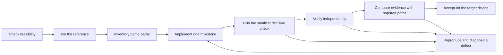

# Port Any Game Anywhere

**Finish the port. Prove the game works.**

An agent skill for taking a game port from its first working scene to a tested release. It guides source recovery, implementation, faithful behavior, complete game paths, and evidence that belongs to the build you actually ship.

A port can boot, display a level, and move a character while its saves, other modes, transitions, or late-game routes still fail. This project makes those gaps visible. It gives each required behavior a completion gate and keeps untested work open.

“Anywhere” describes the ambition. Feasibility still depends on lawful source or binary access, available tools, target limits, time, and access to the devices you intend to support. This skill cannot automatically port every game. It cannot turn an emulator pass into console acceptance.

**Status: development snapshot.** The skill, templates, and worked examples are being prepared for evaluation. The recovery trial, external source-led pilot, live Codex evaluation, and target-device checks are pending. There is no public beta acceptance claim. See [the release gates](STATUS.md).

## Start with a port plan

Use a local checkout or an extracted project archive. Copy the entire skill directory, including its references, templates, and scripts:

```sh
mkdir -p ~/.agents/skills
cp -R skills/port-any-game-anywhere ~/.agents/skills/port-any-game-anywhere
```

If that destination already exists, move the old copy aside before copying. Open Codex in a separate working copy of the game project. Invoke the skill explicitly:

```text
$port-any-game-anywhere

Plan a faithful port of this game to my target.
Inspect the available reference and project first.
Produce a feasibility decision, a game-path inventory,
and acceptance gates before changing game code.
```

The first useful result is a reviewable plan. It identifies the source of truth, missing access, target limits, required game paths, and the next small milestone. It must also be able to say that a port is blocked or infeasible.

Codex is the first evaluation target. Claude Code setup is documented as an optional, untested client route. Other Agent Skills clients remain untested.

Continue with [the first-use guide](docs/first-use.md). Check [compatibility and evaluation status](docs/compatibility.md) before choosing tools.

## What the skill covers

- **Feasibility and source recovery.** Start from available source, partial source, or a binary. Record rights, missing information, dependencies, and recovery limits.
- **The whole game.** Inventory modes, routes, mechanics, transitions, saves, failures, endings, and supported inputs before claiming completion.
- **Authenticity.** Compare behavior, timing, presentation, audio, controls, persistence, and performance with a pinned reference. Track deliberate enhancements separately.
- **Evidence and repair.** Reproduce defects, diagnose their cause, fix them, verify independently, then check affected regressions.
- **Safe continuation.** Keep one completion ledger, durable run records, and a compact handoff. Reuse a result only when every relevant input still matches.

A completion ledger is a list of required behaviors with their implementation state and supporting evidence. A gate is a condition that must pass before a milestone can close. A deterministic test gives the same result when its inputs and environment stay the same.



Read the diagram from left to right. Failures return to diagnosis and a bounded fix. Implementation alone does not close a milestone.

## Examples and evidence

[Sonic CD Saturn / CD++](docs/case-studies/sonic-cd.md) is the main process case study. Its records show why implemented features, historical test passes, current validation, and console acceptance need separate labels. The full game remains unaccepted in the reviewed snapshot.

Two redistributable examples are planned for evaluation:

- **Switchboard:** an original six-board puzzle. Recover a stripped C executable into buildable C, then port it to a TypeScript browser game. The original source stays hidden during the recovery trial.
- **Fifteen:** reproduce an existing source-led browser port from Simon Tatham’s puzzle collection. The existing upstream web port is disclosed. This checks onboarding, inventory, builds, and evidence. It is not a claim to have invented a new port.

Expected outputs are specifications until a completed run supplies evidence. See [the example directory](examples/) and [evaluation material](evals/).

## Designed for bounded agent work

Search before reading. Investigate one uncertainty at a time. Run the smallest check that can settle it. Keep tool output short and retain full evidence in artifacts. After two failed fixes to the same problem, revisit the diagnosis.

The skill uses explicit invocation. It does not install a decompiler, create background jobs, or require a new game engine. Detailed references load when their topic becomes relevant. Platform adapters describe the extra work for a specific tool or target. They do not imply tested support.

## Project guide

- [First use](docs/first-use.md)
- [Compatibility and requirements](docs/compatibility.md)
- [Research and source dates](docs/research.md)
- [Sonic CD case study](docs/case-studies/sonic-cd.md)
- [Contributing](CONTRIBUTING.md)
- [Security and private data](SECURITY.md)
- [Third-party material](THIRD-PARTY.md)
- [Release gates](STATUS.md)
- [Changelog](CHANGELOG.md)

Original project code and documentation use the [MIT license](LICENSE). Original example assets use CC0 only where marked. Game data and third-party source retain their own licenses. No proprietary game assets, BIOS files, or disc images belong in this repository.
